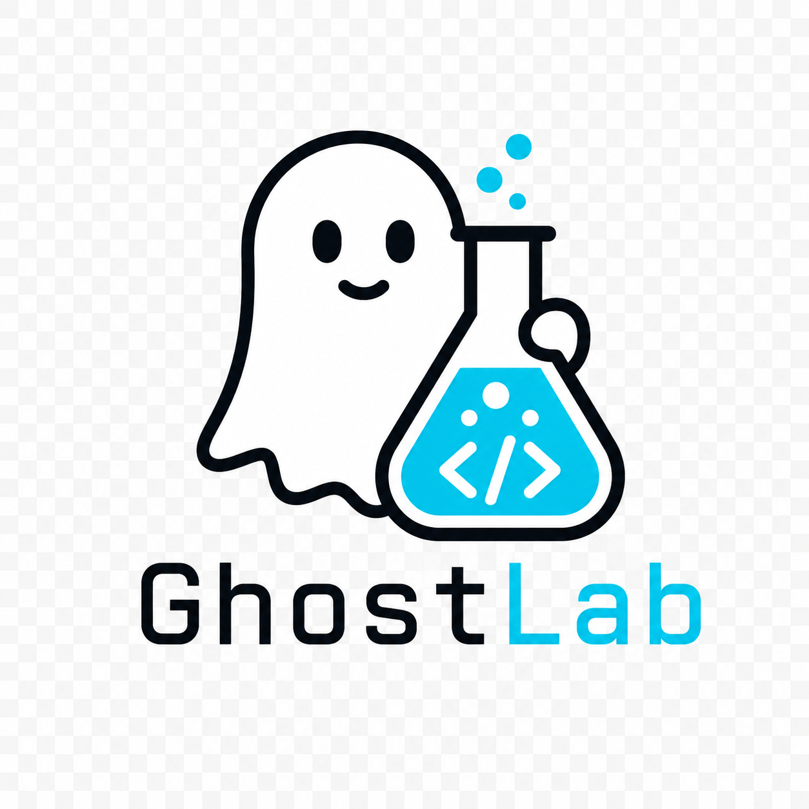

<p align="center"></p>

# Ghostlab

**A headless runner for coding agents, and a Python SDK for composing them
into checkpointed, resumable jobs.**

Define an agent once — harness, model, instructions, skills, MCP servers,
workspace — and run it in **Claude Code, Codex, GitHub Copilot CLI, or
OpenCode**, on your machine or inside an **NVIDIA OpenShell** sandbox. Then
chain agent calls into pipelines for evaluations, labeling, testing, or any
batch job: every item and every agent call is checkpointed, so an interrupted
run picks up where it stopped.

Ghostlab is infrastructure. It has no opinion about what your job does — an
MCP evaluation is just [one example pipeline](examples/mcp-eval/pipeline.py).

```bash
pip install ghostlab
```

## Run an agent

```yaml
# agent.yaml
name: reviewer
harness: claude            # claude | codex | copilot | opencode | command
model: sonnet
instructions: Be concise.
skills: [skills/review]
mcps:
  docs: {command: node, args: [docs-mcp.js]}
workspace: repo            # the agent works on a private copy
sandbox: {backend: openshell, providers: [anthropic]}
```

```bash
ghostlab exec --agent agent.yaml "Review src/app.py" --collect REVIEW.md
```

```python
from ghostlab import Agent

agent = Agent.load("agent.yaml")
result = agent.run("Review src/app.py and reply with JSON")
result.status, result.answer, result.tool_calls, result.json()

with agent.session() as chat:          # multi-turn: the harness session resumes
    chat.send("Find the bug")
    chat.send("Now fix it")
```

## Compose a pipeline

```python
from ghostlab import Agent, Pipeline, stage

@stage                                   # one output per item
def describe(ctx, target):
    explorer = ctx.agent("assistant").with_mcp(target["id"], target["mcp"])
    return {**target, "capabilities": ctx.run(explorer, "What can this MCP do? JSON.").json()}

@stage(fan_out=True)                     # a list: each element becomes an item
def scenarios(ctx, target):
    return ctx.run(ctx.agent("planner"), f"Write test goals for {target}. JSON list.").json()

@stage(concurrency=4, retries=1)         # parallel, retried on failure
def evaluate(ctx, scenario):
    ...

@stage(gather=True)                      # every surviving item at once
def report(ctx, results):
    ...

pipeline = Pipeline("mcp-eval", [describe, scenarios, evaluate, report],
                    params={"assistant": Agent.load("agents/assistant.yaml"),
                            "planner": Agent.load("agents/planner.yaml")})
```

```bash
ghostlab run pipeline.py --input targets.jsonl                  # run
ghostlab run pipeline.py                                        # resume
ghostlab run pipeline.py --param assistant=agents/codex.yaml    # swap an agent
ghostlab status runs/mcp-eval
```

- **Checkpointed:** each item's outcome is saved as it finishes. So is each
  agent call inside an item, so an item that failed halfway reuses the calls
  that completed.
- **Resumable:** re-running skips done items and retries failed ones. A changed
  input, parameter, or stage `version` recomputes only what it affects.
- **Classified failures:** `timed_out`, `model_unavailable`, `sandbox_error`,
  `harness_error`, and `agent_error` are kept apart, so "the agent got it wrong"
  never looks like "the infrastructure broke".

## Examples

| Example | What it shows |
| --- | --- |
| [`examples/mcp-eval`](examples/mcp-eval/pipeline.py) | describe an MCP → generate scenarios → emulated-user conversations judged by an agent → report |
| [`examples/batch-label`](examples/batch-label/pipeline.py) | label a dataset with eight agents in parallel, validating every answer |
| [`examples/release-notes`](examples/release-notes/agent.yaml) | one configured agent with instructions, a skill, and a workspace |
| [`examples/agents`](examples/agents) | a starting config for each harness |

## Documentation

<https://sajjadgg.github.io/Ghostlab/> — [getting started](docs/getting-started.md),
[agents](docs/agents.md), [pipelines](docs/pipelines.md), [CLI](docs/cli.md).

## License

MIT
